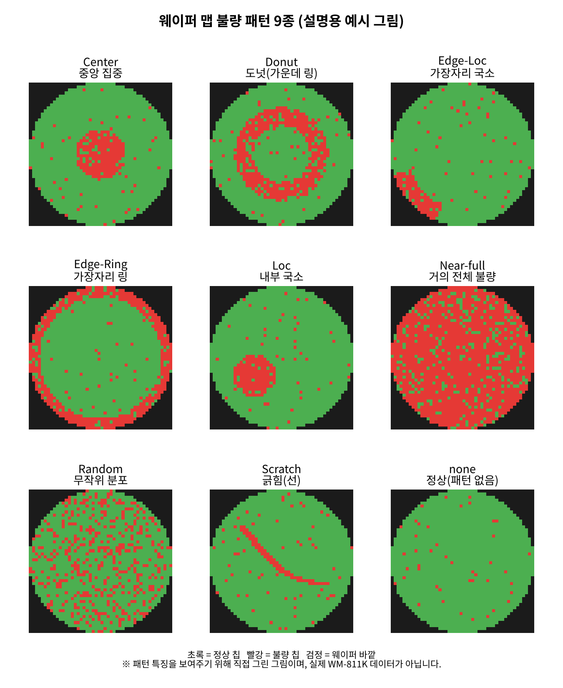

# Wafer Defect Classifier — 웨이퍼 맵 불량 패턴 분류기

> 가천대학교 2026-2학기 「오픈소스 SW」 텀 프로젝트

반도체 웨이퍼 맵을 입력하면 불량이 어떤 모양으로 분포하는지 9가지 패턴 중 하나로 자동 분류하는 오픈소스 프로젝트입니다.

<!-- TODO(김동찬): 데모 스크린샷 또는 GIF를 assets/에 넣고 아래 줄의 주석을 풀어주세요 -->
<!--  -->

## 프로젝트 개요

### 웨이퍼 맵이란?

반도체는 웨이퍼라는 둥근 실리콘 판 위에 같은 칩을 수백 개씩 만들고, 나중에 잘라서 사용합니다. 제작이 끝나면 칩을 하나씩 검사해 정상/불량을 표시하는데, 이것을 웨이퍼 위치대로 그린 지도가 **웨이퍼 맵**입니다.

불량 칩이 어떤 **모양**으로 몰려 있는지 보면 어느 공정에서 문제가 생겼는지 추정할 수 있습니다. 하지만 공장에서는 웨이퍼가 매우 많이 생산되므로 사람이 일일이 확인하기 어렵습니다. 이 프로젝트는 이 분류 작업을 딥러닝 모델로 자동화합니다.

### 불량 패턴 9종

<p align="center">
  
</p>

> 위 그림은 패턴 특징을 설명하기 위해 직접 그린 예시입니다. 실제 WM-811K 데이터로 만든 그림으로 추후 교체할 예정입니다.

| 패턴 | 설명 |
| --- | --- |
| Center | 웨이퍼 중앙에 불량이 몰림 |
| Donut | 중앙을 둘러싼 링 모양 |
| Edge-Loc | 가장자리 한쪽에 국소적으로 몰림 |
| Edge-Ring | 가장자리 전체를 따라 링 모양 |
| Loc | 내부 어딘가에 덩어리로 몰림 |
| Near-full | 웨이퍼 거의 전체가 불량 |
| Random | 특정 모양 없이 흩어짐 |
| Scratch | 선 모양으로 이어짐 |
| none | 뚜렷한 패턴 없음 |

## 데이터셋

<!-- TODO(김민재): 데이터셋 링크, 라이선스, 원본 클래스 분포표, 전처리·불균형 처리 방법 작성 -->

- 데이터셋: WM-811K (Kaggle, 파일명 `LSWMD.pkl`)
- 원본 데이터는 용량이 커서 저장소에 포함하지 않습니다. 아래 "실행 방법"을 참고해 직접 내려받아 주세요.

## 모델 및 결과

<!-- TODO(백찬호): 사용한 사전학습 모델, 학습 설정, 실험 비교표 작성 -->
<!-- TODO(김동찬): 테스트 정확도, 클래스별 성능, 혼동행렬 그림 추가 -->

## 사용한 패키지

<!-- TODO: 마지막에 pip freeze로 실제 버전을 확인해서 채우기 -->

| 패키지 | 버전 |
| --- | --- |
| Python | 3.10 |
| opencv-python | |
| numpy | |
| pandas | |
| scikit-learn | |
| matplotlib | |
| torch | |
| transformers | |

## 실행 방법

```bash
# 1. 저장소 받기
git clone https://github.com/KIMDONGJIN-0515/wafer-defect-classifier.git
cd wafer-defect-classifier

# 2. 가상환경 만들기
conda create -n wafer python=3.10
conda activate wafer
pip install -r requirements.txt

# 3. 데이터 준비: Kaggle에서 LSWMD.pkl을 받아 data/ 폴더에 넣기
```

<!-- TODO: 전처리, 학습, 평가, 예측 실행 명령어를 각 담당자가 추가 -->

## 프로젝트 구조

```
wafer-defect-classifier/
├── wafer/                # 직접 만든 패키지
│   ├── data.py           # 데이터 불러오기·전처리
│   ├── visualize.py      # 웨이퍼 맵 시각화
│   ├── model.py          # 모델 정의
│   ├── train.py          # 학습
│   ├── evaluate.py       # 평가
│   └── predict.py        # 예측
├── notebooks/            # 실험 노트북
└── assets/               # README용 이미지
```

## 팀원

| 이름 | 역할 |
| --- | --- |
| 김동진 (팀장) | 저장소 관리, 시각화, README |
| 김민재 | 데이터 수집·전처리 |
| 백찬호 | 모델 학습 |
| 김동찬 | 평가·데모 |

## 참고 자료

<!-- TODO: 참고한 자료, 튜토리얼, 블로그, 소스 코드를 빠짐없이 적기 -->

- WM-811K 데이터셋 (Kaggle)
- Hugging Face Transformers 공식 문서

## 라이선스

이 프로젝트는 MIT 라이선스를 따릅니다. 자세한 내용은 [LICENSE](LICENSE)를 참고하세요.
